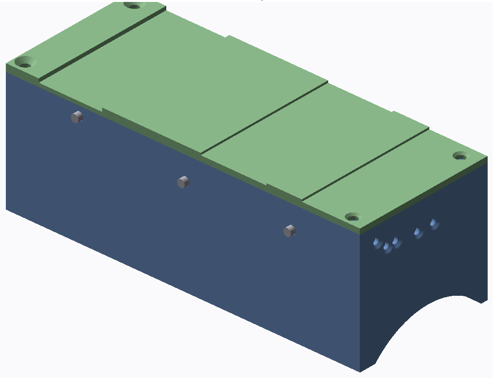

# Bionic Phoenix hand

A servo driven version of the e-NABLE Phoenix Hand v3.

A printed module slides onto the dovetail rail of the Phoenix gauntlet, in the place of the tensioner block, and holds three servos, an Arduino Nano and the EMG board. The servos wind the finger strings onto small spools, so the hand itself is unchanged apart from the wrist being locked. A dry electrode EMG pad sits on the underside of the forearm, held by the same velcro strap that holds the module on. Tense the forearm and the hand closes, relax and it opens.

Everything is printed at 120 %, the same scale as the hand.

## Files

- `stl/` ready to print. The base and lid come in left and right hand versions. Print one spool per servo and one EMG backer.
- `step/` the full assembly (module, servos, spools and pins) for Fusion 360 or any other CAD.

## Parts

- e-NABLE Phoenix Hand v3 at 120 %, wrist locked with bolts
- 3 x DS3218 servo (20 kg cm, 270 degree). One for the thumb, one for index and middle, one for ring and little. The mounting tabs are cut off so they fit
- Arduino Nano (no headers)
- DFRobot analog EMG sensor (SEN0240) with the dry electrode pad
- ACS712 current sensor on the servo supply
- 2S LiPo and a 6 V 5 A UBEC, or a USB power bank that can give 3 A
- 0.8 mm braided fishing line for the finger strings
- 3 x 14 mm steel dowel pins for the string guides, 4 x M3 countersunk screws for the lid
- 25 mm velcro strap

## Printing

PLA or PETG, 0.2 mm layers, 4 walls, 30 % infill. Stand the base on its wrist end (the face with the five string holes) and it needs no supports, just a brim. Lid top face down, spools flat, EMG backer strap side down. Check the slide on your own gauntlet and open the slot a little if it is tight. TPU pads on the fingertips make a big difference to the grip.

## Notes

A 500 g bottle needs about 90 N on each pair of finger strings with grippy fingertips. A DS3218 on the 5 mm spool gives around 200 N before it stalls, so there is a bit over 2x margin. The current sensor is there so a blocked finger stops the servo before it snaps the string.

Phoenix Hand v3 is by e-NABLE, CC BY 4.0.
